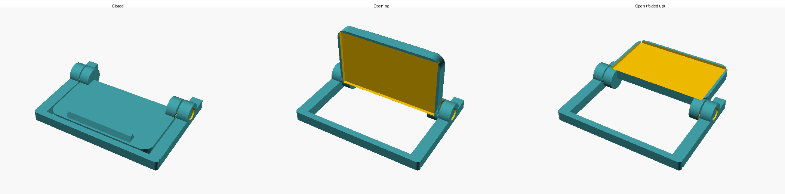

# Leapmotor B05 driver-camera privacy cover

A flip-up lid for the driver-monitoring camera on the left A-pillar. A rectangular frame is taped to the camera pod. The lid hangs over the lens when closed and folds up 180° onto the frame when open, and it clicks into place in both positions.

It prints **as one piece with the hinge already assembled** (print-in-place). It needs no supports and no assembly.

## Why a flip lid and not a slider

The camera pod is small. Its face is only about 18 mm tall, with a window of about 20 × 11.5 mm, about 4 mm of face above it, 4.5 mm on each side and 2.5 mm below. A sliding shutter would stick far out past the pod. A lid hinged on the top edge fits.

## Size (defaults)

| | |
|---|---|
| Frame | 26.6 × 17.9 mm, 4.4 mm thick at the hinge, 2 mm elsewhere |
| Lid | covers 21.6 × 12.6 mm (window + 0.8 mm overlap) |
| Crossbar | 1.2 mm bar under the lid joining both legs, ending ~2.3 mm below the window. Set `bottom_bar = false` to drop it |
| Needs | 4.1 mm of face above the window, ~3.3 mm on each side, ~2.3 mm below |

The hinge knuckles sit only at the two ends of the lid, so the open lid leaves the window clear.

**About the measurements:** the pod sticks out 5–6 cm from the pillar. A ruler or tape hooked onto the pillar or the back of the pod therefore reads about 25% too big in photos. That's why the first prints were oversized. Measure with the tape flat against the pod's front face.

## Fit test first

`fit-test.stl` is a 0.6 mm flat outline of the frame with the window cut out. It prints in a few minutes. Hold it on the pod: the window hole should sit just around the dark window, and the outline should stay on the pod face. If it's off, change `win_w` / `win_h` (or `strip_h` for the top) and print the test again.

## Print (Bambu Lab A1)

- **Black PETG** (or ASA). PLA softens behind a windscreen. Use an opaque dark colour, because the camera uses infrared light.
- 0.2 mm layers, 3 walls, no supports, printed flat as exported.
- After printing, bend the lid gently to break the hinge free.
- If the hinge fuses, raise `g` (0.35 → 0.4). If the click is too stiff or too weak, change `det` (0 = no click).

## Fit

1. Peel off the clear protective film tab on the lens if it's still there.
2. Clean the pod face with isopropyl alcohol.
3. Stick the frame on with **thin foam VHB tape** (~0.8–1 mm) on the strip and both legs (the crossbar may not touch the pod, which is fine). Put the hinge just above the window's top edge.

To change sizes, open `camera-cover.scad` in OpenSCAD (Window → Customizer) or in MakerWorld's Parametric Model Maker. Set `part = preview` and `open_angle` to see it move.

> This is the driver attention/fatigue camera. With the lid closed, the car will probably show a warning or switch off driver-monitoring features.
